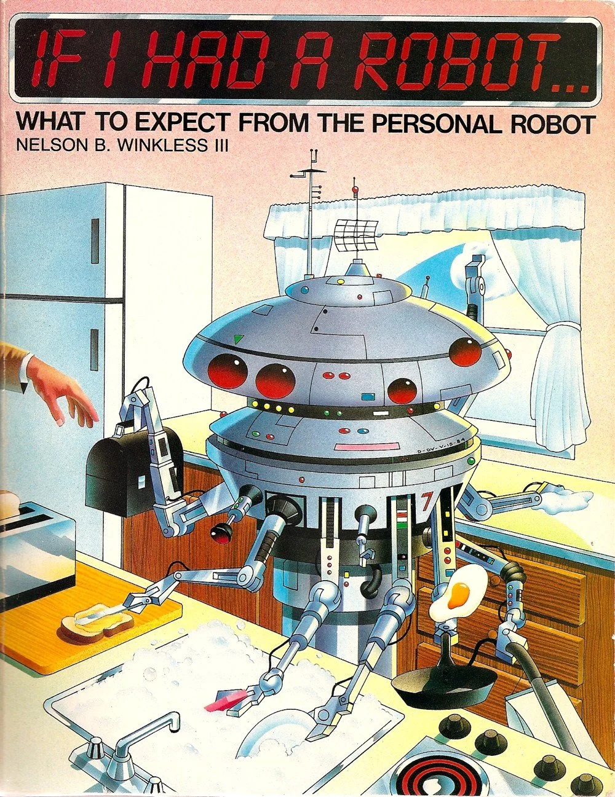
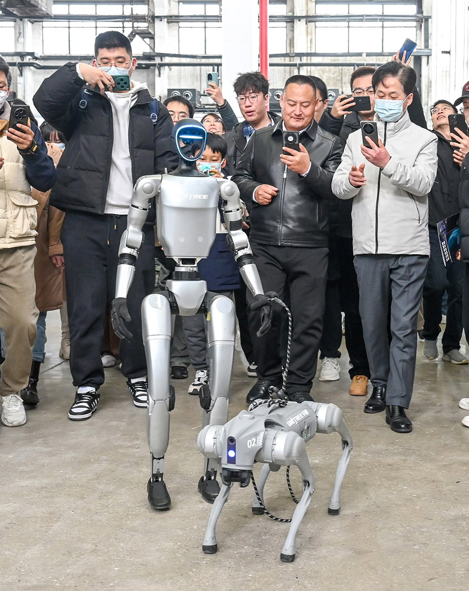
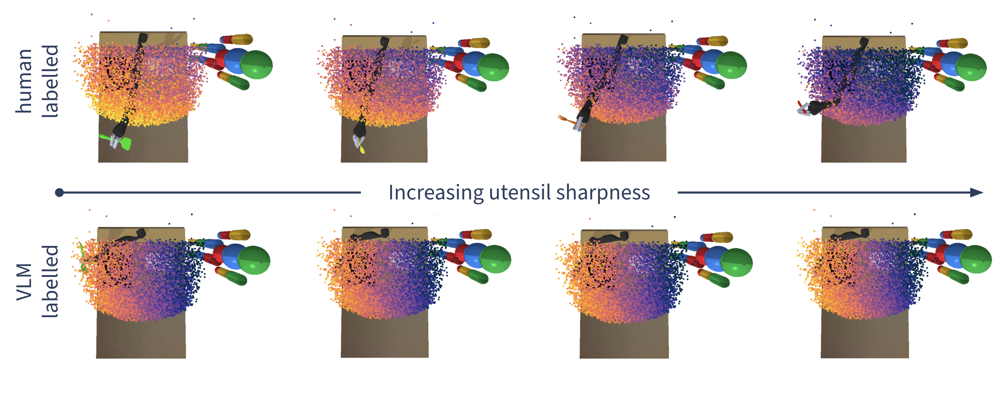

# ($\phi$)toshop: *human-robot alignment as craft*
*Miranda Li*
<!-- TODO design this slide! maybe make a collage? -->

<!-- # Motivation -->
<!--  -->

<figure style="flex: 1; min-width: 0; margin: 0;">

<figcaption style="font-size: 0.6em;">If I Had a Robot: What to Expect from the Personal Robot, 1984</figcaption>
<!-- src: https://paleofuture.com/blog/2008/7/21/if-i-had-a-robot-1984.html -->
</figure>
<figure style="flex: 1; min-width: 0; margin: 0;">

<figcaption style="font-size: 0.6em;">Shenzhen, 2025</figcaption>
<!-- src: https://www.chinadailyhk.com/hk/article/605439 -->
</figure>

<!-- # Existing work -->
<!-- annotate personal robot image: what matters: stove is hot, keep knife away from person, butter goes on toast not plate... -->
To get intelligent, autonomous robots to work safely alongside humans, we need robots to understand what we care about ("features"), which can often be hard to communicate

Existing methods are...

    

        
preference pairs

        
demonstrations

        
corrections

    

    

        

        tedious
        

        

        expensive
        

        

        uninterpretable
        

    

Maybe LLMs / VLMs are the answer?

    "the sharper the utensil the further away from the person it should be"
    

Language is too ambiguous to capture specific spatial relationships.

<!-- # ($\phi$)toshop -->
<section data-auto-animate>
    
    <!-- <h1>($\phi$)toshop</h1> -->

An interactive visual interface 

which makes the robot's representation directly manipulable 

via visual annotation,

and the algorithm to make this possible.
</section>

    

        

        <h3 > Existing methods</h3>
        

        
tedious

        
expensive

        
uninterpretable

        
ambiguous

    

    

    

        
        

        

        intuitive
        

        

        efficient
        

        

        interpretable by design
        

        

        precise
        

    

## interface
direct manipulation
interpretability interfaces

## algo
$r(s) = \theta \cdot \phi(s)$
targeted ...

## eval

## tasks / baselines

# goal
representational alignment as craft
end-user robot programming

# thanks for listening
Advisor: Cynthia Breazeal

Thesis readers: Arvind Satyanarayan, Andreea Bobu, Crystal Lee

# appendix
timeline