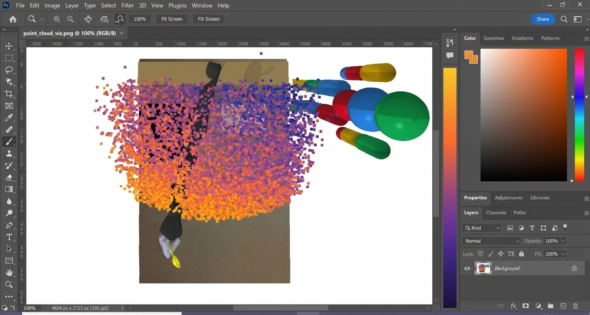
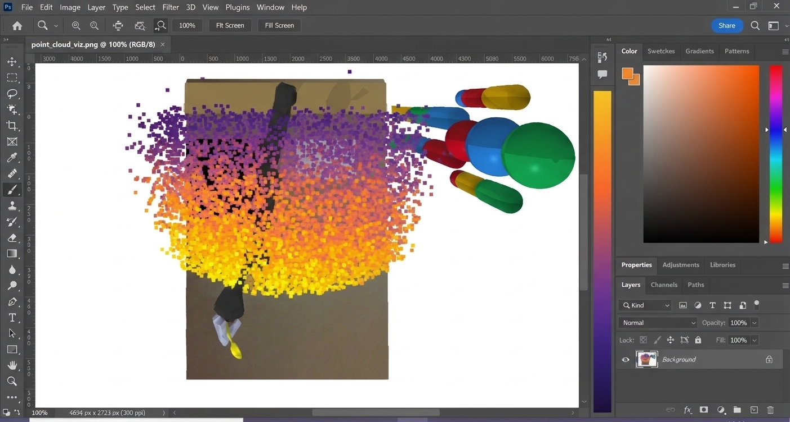

# ($\phi$)toshop: *human-robot alignment as craft*
*Miranda Li*
<!-- TODO design this slide! maybe make a collage? -->
Advisor: Cynthia Breazeal
<!-- at prg we are ... -->

Thesis readers: Arvind Satyanarayan, Andreea Bobu, Crystal Lee
<!-- arvind does ..., andreea does ..., crystal does ... -->

<!-- # Motivation -->
<!--  -->

<figure style="flex: 1; min-width: 0; margin: 0;">

<figcaption style="font-size: 0.6em;">If I Had a Robot: What to Expect from the Personal Robot, 1984</figcaption>
<!-- src: https://paleofuture.com/blog/2008/7/21/if-i-had-a-robot-1984.html -->
</figure>
<figure style="flex: 1; min-width: 0; margin: 0;">

<figcaption style="font-size: 0.6em;">Shenzhen, 2025</figcaption>
<!-- src: https://www.chinadailyhk.com/hk/article/605439 -->
</figure>

<!-- # Existing work -->
reveal meme robots -> math with legs
there's nothing magical about robots. they are just math with legs.
To get intelligent, autonomous robots to work safely alongside humans, we need to specify what we care about in math.
<!-- we need robots to understand what we care about ("features"), which can often be hard to communicate -->

<!-- We want to learn / specify: -->
<!-- animate + annotate personal robot image: what matters: stove is hot, keep knife away from person, butter goes on toast not plate... -->

$r(s)$: reward function ("how good is this state?")
<!-- as a person, how good is this state? great - toast being buttered, dish being washed, egg cooking successfully-->

$\phi(s)$: features ("what is important about this state?")
<!-- NOT important that the toaster is on the cutting board, sponge to the right of the plate-->
<!-- what is important:  we need the robot to know that
the stove is hot,
keep knife away from person,
butter goes on the toast, not on the plate in the sink-->

We often assume:

$r(s) = \theta \cdot \phi(s)$ ("how good this state is depends linearly on its features")
<!-- Algorithmic human-robot interaction models human preferences as a reward function over the state, r(s). The robot chooses its actions to maximize expected reward. 
Rather than learning this reward directly from the raw state s, the robot can first learn features phi(s) that capture what the human cares about (e.g., distance to the person, efficiency), and then learn a reward over those features, often as a weighted sum,
theta dot phi(s). -->

Existing methods are...

    

        

            

            labelled preference pairs
            

            
        

        

            

            demonstrations + corrections
            

            
        

        

            

            language
            

            
        

        <!-- 
NNs in general
 -->
    

    

        

        tedious
        

        

        expensive
        

        

        ambiguous
        

        <!-- 

        uninterpretable
        
 -->
    

<!-- Maybe LLMs / VLMs are the answer?

How close is "too close"?

 -->
<!-- 

Language is too ambiguous for specific spatial relationships, and LLMs encode strong priors.

 -->

<!-- # ($\phi$)toshop -->
<section data-auto-animate>
    
    <!-- <h1>($\phi$)toshop</h1> -->
<!-- 
an interactive visual interface 
which makes the robot's representation directly manipulable 
via visual annotation,
and the algorithm to make this possible. -->

    

        
    

    

        
    

</section>

but what about $r(s) = \theta \cdot \phi(s)$?

overlaying layers with different opacities

## evaluating the interface
<!-- direct manipulation
interpretability interfaces -->
* NASA TLX: task load index
* effort: clicks, keystrokes, time taken
* perceived control and usefulness
* task success: scored against task-specific rubric

## evaluating the algorithm
$r(s) = \theta \cdot \phi(s)$
* reaction: oracle annotations move feature towards ground truth values
* isolation: oracle annotations do not affect elems of state irrelevant to feature
* efficiency: ms taken to update

## tasks / baselines
gridrobot
vehicle parking
swimmer letters (if time)

    

        

        <h3 > Existing methods</h3>
        

        
tedious

        
expensive

        
ambiguous

        <!-- 
uninterpretable
 -->
    

    

    

        
        

        

        intuitive
        

        

        efficient
        

        

        precise
        

        <!-- 

        interpretable by design
        
 -->
    

# goal
representational alignment as craft
end-user robot programming
(same image as title slide)

# Thank you!

# appendix
timeline
phitoshop sketches
tool descriptions