# ($\phi$)toshop: 
## *human-robot alignment as craft*
*Miranda Li*

<h3>Thesis readers</h3>

    

        Cynthia Breazeal
        
    

    

        Arvind Satyanarayan
        
    

    

        Andreea Bobu
        
    

    

        Crystal Lee
        
    

<!-- # Motivation -->
<!--  -->

<figure style="flex: 1; min-width: 0; margin: 0;">

<figcaption style="font-size: 0.6em;">If I Had a Robot: What to Expect from the Personal Robot, 1984</figcaption>
<!-- src: https://paleofuture.com/blog/2008/7/21/if-i-had-a-robot-1984.html -->
</figure>
<figure style="flex: 1; min-width: 0; margin: 0;">

<figcaption style="font-size: 0.6em;">Shenzhen, 2025</figcaption>
<!-- src: https://www.chinadailyhk.com/hk/article/605439 -->
</figure>

<!-- # Existing work -->

<!-- reveal meme robots -> math with legs
there's nothing magical about robots. they are just math with legs.
To get intelligent, autonomous robots to work safely alongside humans, we need to specify what we care about in math. -->
<!-- we need robots to understand what we care about ("features"), which can often be hard to communicate -->

    

        

            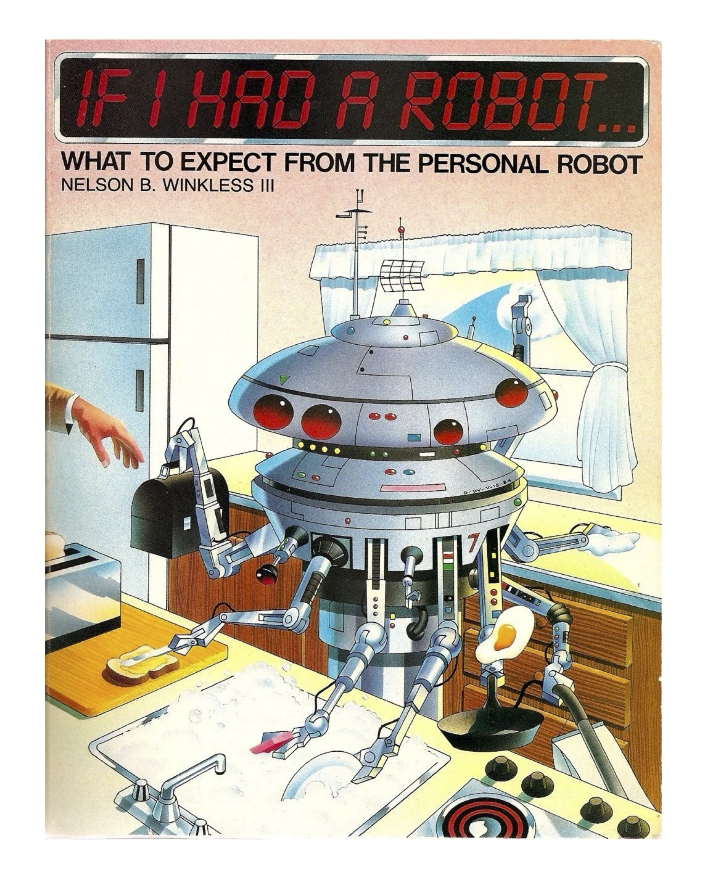
        

        

            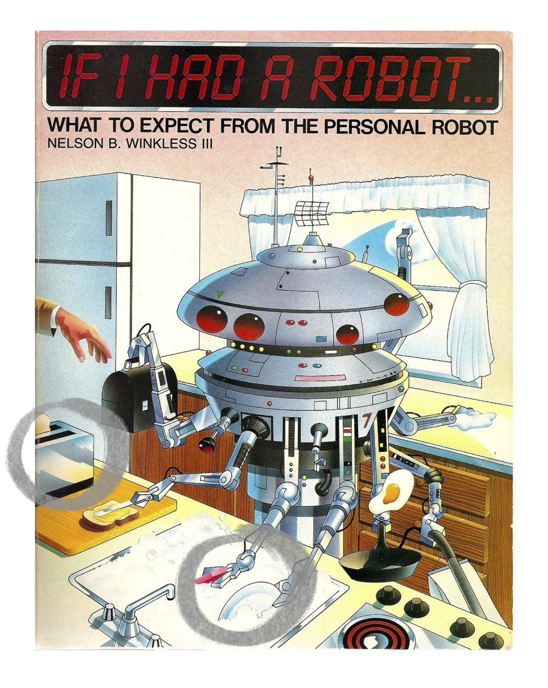
        

        

            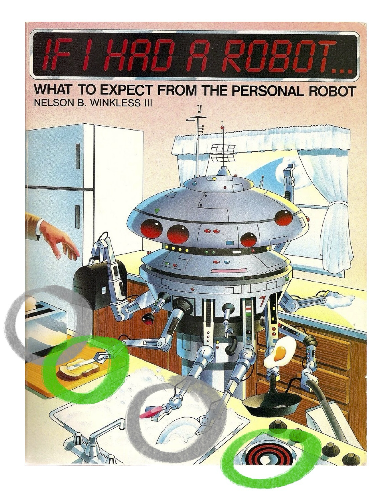
        

    

    

        

            $r(s)$: reward function ("how good is this state?")
        

        

            Learning features, then combining them into rewards, is more efficient and generalizable than learning rewards from the state directly.
            <small style="display: block; margin-top: 0.75em; font-size: 0.45em; color: #666;">
            Bobu, A., Wiggert, M., Tomlin, C., & Dragan, A. D. (2022). Inducing structure in reward learning by learning features. The International Journal of Robotics Research, 41(5), 497-518.
            </small>
        

        

            $\phi(s)$: features ("what is important about this state?")
        

        

            We assume $r(s) = \theta \cdot$$\phi(s)$.
        

        

            How do we teach the robot the features $\phi(s)$ we care about?
        

    

Existing methods are...

    

        

        

            

            labelled preference pairs
            

            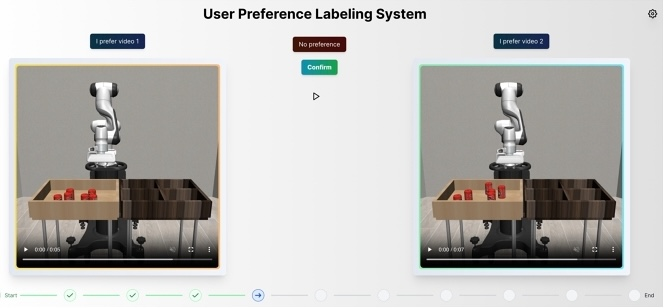
            <small style="display: block; margin-top: 0.75em; font-size: 0.45em; color: #666;">
            Lyu, H., Bai, Y., Liang, X., Das, U., Shi, C., Gong, L., ... & Ma, X. (2024, March). FARPLS: A feature-augmented robot trajectory preference labeling system to assist human labelers’ preference elicitation. In Proceedings of the 29th International Conference on Intelligent User Interfaces (pp. 344-369).
            </small>
        

        

        

        

            

            demonstrations + corrections
            

            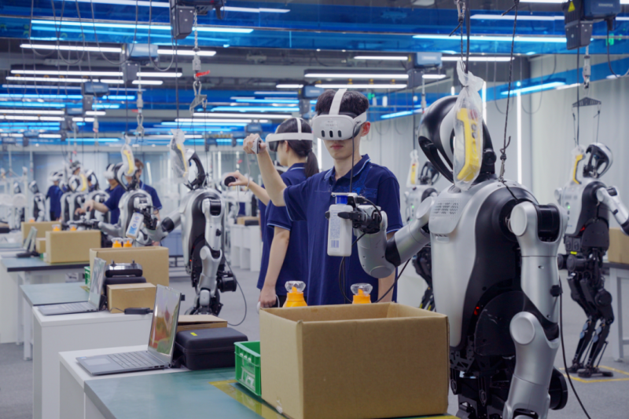
            <small style="display: block; margin-top: 0.75em; font-size: 0.45em; color: #666;">
            For example, (not pictured):
             
            Demonstrations:
             
            Finn, C., Levine, S., & Abbeel, P. (2016, June). Guided cost learning: Deep inverse optimal control via policy optimization. In International conference on machine learning (pp. 49-58). PMLR.
             
            Corrections:
             
            Bajcsy, A., Losey, D. P., O’malley, M. K., & Dragan, A. D. (2017, October). Learning robot objectives from physical human interaction. In Conference on robot learning (pp. 217-226). PMLR.
            </small>
        

        

        

            

            language
            

            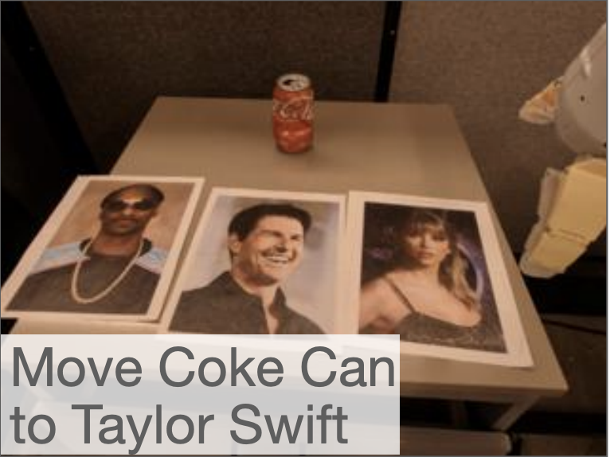
            <small style="display: block; margin-top: 0.75em; font-size: 0.45em; color: #666;">
            Kim, M. J., Pertsch, K., Karamcheti, S., Xiao, T., Balakrishna, A., Nair, S., ... & Finn, C. (2024). OpenVLA: An open-source vision-language-action model. arXiv preprint arXiv:2406.09246.
            </small>
        

    

    

        

        tedious
        

        

        expensive
        

        

        ambiguous
        

    

Existing methods **cast the human as** a...

    

        

        

            

            labelled preference pairs
            

            
            <small style="display: block; margin-top: 0.75em; font-size: 0.45em; color: #666;">
            Lyu, H., Bai, Y., Liang, X., Das, U., Shi, C., Gong, L., ... & Ma, X. (2024, March). FARPLS: A feature-augmented robot trajectory preference labeling system to assist human labelers’ preference elicitation. In Proceedings of the 29th International Conference on Intelligent User Interfaces (pp. 344-369).
            </small>
        

        

        

        

            

            demonstrations + corrections
            

            
            <small style="display: block; margin-top: 0.75em; font-size: 0.45em; color: #666;">
            For example, (not pictured):
             
            Demonstrations:
             
            Finn, C., Levine, S., & Abbeel, P. (2016, June). Guided cost learning: Deep inverse optimal control via policy optimization. In International conference on machine learning (pp. 49-58). PMLR.
             
            Corrections:
             
            Bajcsy, A., Losey, D. P., O’malley, M. K., & Dragan, A. D. (2017, October). Learning robot objectives from physical human interaction. In Conference on robot learning (pp. 217-226). PMLR.
            </small>
        

        

        

            

            language
            

            
            <small style="display: block; margin-top: 0.75em; font-size: 0.45em; color: #666;">
            Kim, M. J., Pertsch, K., Karamcheti, S., Xiao, T., Balakrishna, A., Nair, S., ... & Finn, C. (2024). OpenVLA: An open-source vision-language-action model. arXiv preprint arXiv:2406.09246.
            </small>
        

    

    

        

            

            data labeller
            

            <!--  -->
        

        

            

            data labeller but with more steps
            

            <!--  -->
        

        

            

            prompt engineer
            

            <!--  -->
        

        <!-- images -->
        

            

                
            

            

                
            

            
        

    

<!-- .slide: data-auto-animate data-background-color="black" data-transition="zoom"-->
# ($\phi$)toshop: 
## *human-robot alignment as craft*

<!-- .slide: data-auto-animate -->

<h3>Workflow</h3>

    

        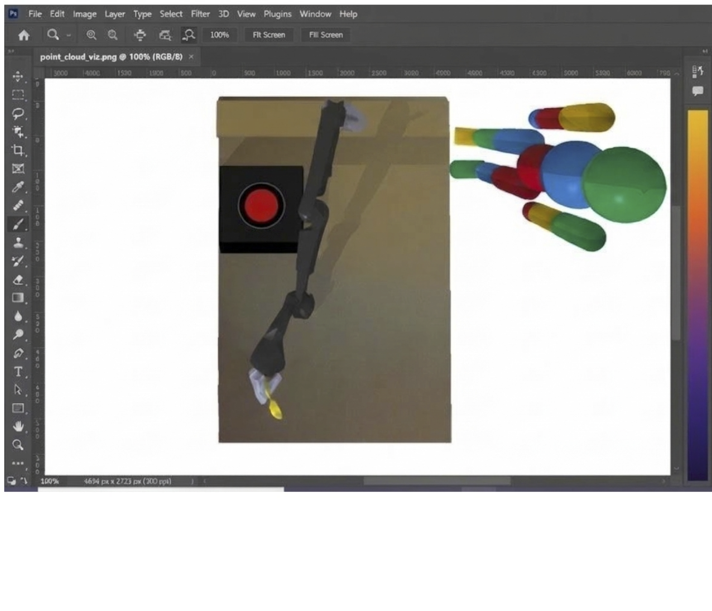
    

    

        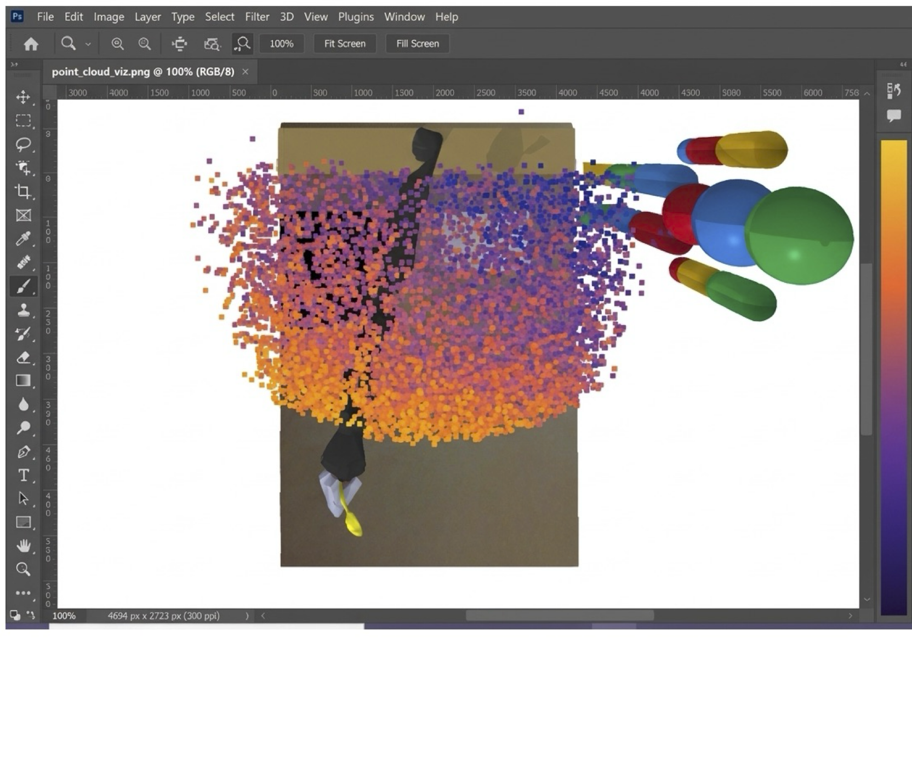
    

    

        
    

    

        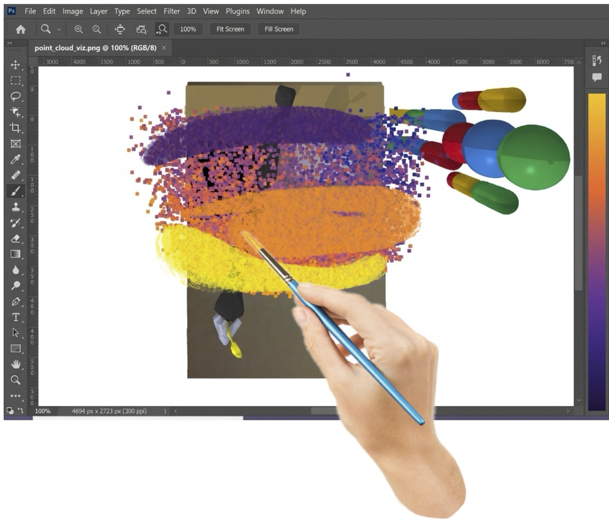
    

    

        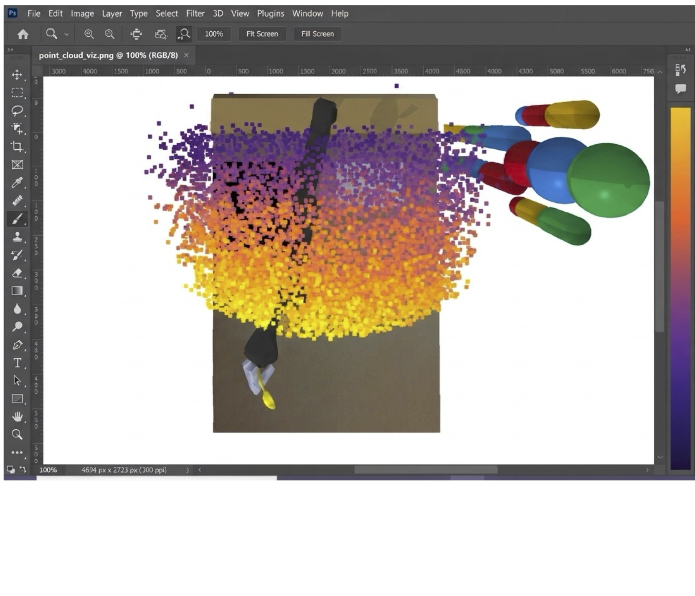
    

    

        
    

    

        Editing a single feature $\phi_i$: spoon distance
    

    

        Visualize robot's current feature network $\phi_i$ for all states
         
        (orange = high value, purple = low value)
    

    

        User selects annotation tool
    

    

        User makes annotations $A$
    

    

    	Algorithm $f(\phi_i, A)$ updates previous feature network $\phi_i$ to $\phi_i'$ according to annotations
    

    <!-- 

       hello 
    
 -->

## Interface

<!-- 
* Direct manipulation
<small style="font-size: 0.45em; color: #666;width:400px">
Hutchins, E. L., Hollan, J. D., & Norman, D. A. (1986). Direct manipulation interfaces. In User centered system design (pp. 87-124). CRC Press.
</small>

* Interpretability interfaces
<small style="font-size: 0.45em; color: #666;width:400px">
Boggust, A., Bang, H., Strobelt, H., & Satyanarayan, A. (2025, April). Abstraction alignment: comparing model-learned and human-encoded conceptual relationships. In Proceedings of the 2025 CHI Conference on Human Factors in Computing Systems (pp. 1-20).
</small> -->
<!-- * End-user programming -->

## Interface: tools

    

        Paintbrush
        
    

    

        Monotonic lines
        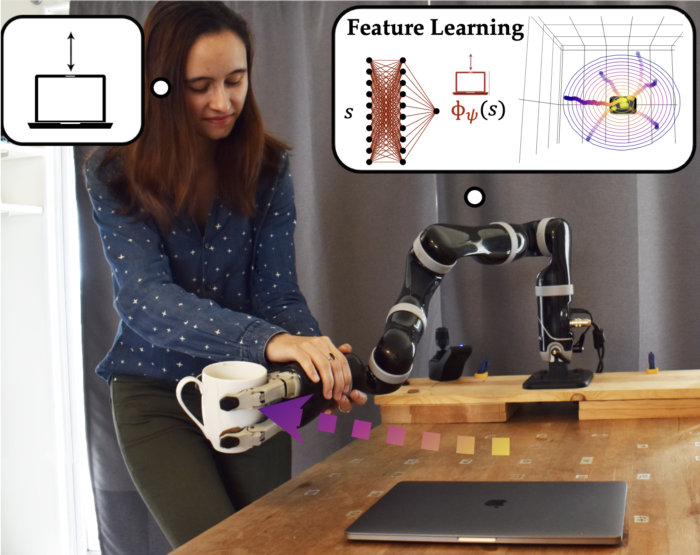
        <small style="display: block; margin-top: 0.75em; font-size: 0.45em; color: #666;">
        Bobu, A., Wiggert, M., Tomlin, C., & Dragan, A. D. (2022). Inducing structure in reward learning by learning features. The International Journal of Robotics Research, 41(5), 497-518.
        </small>
    

    

        Language (chat)
        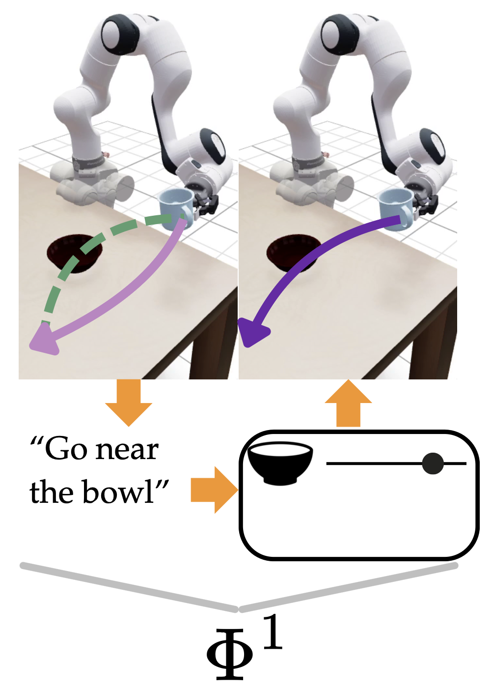
        <small style="display: block; margin-top: 0.75em; font-size: 0.45em; color: #666;">
        Lee, A., Dennler, N., Sucholutsky, I., & Bobu, A. (2026). Flexible Language-Guided Representation Editing for Adaptive Robot Behavior. arXiv preprint arXiv:2610.28893.
        </small>
    

## Interface: evaluation
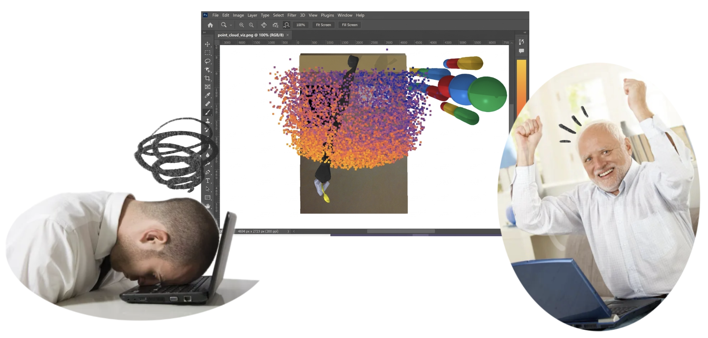

<!-- direct manipulation
interpretability interfaces -->
* NASA TLX: task load index
<small style="font-size: 0.45em; color: #666; width:400px">
Hart, S. G., & Staveland, L. E. (1988). Development of NASA-TLX (Task Load Index): Results of empirical and theoretical research. In Advances in psychology (Vol. 52, pp. 139-183). North-holland.
</small>

* Clicks, keystrokes, time taken
* Perceived control and usefulness
<!-- * task success: scored against task-specific rubric -->

<!-- .slide: data-auto-animate -->
## Algorithm
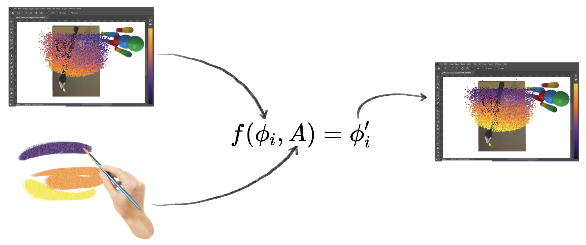

<!-- .slide: data-auto-animate -->
## Algorithm: evaluation

* Reaction: annotations move feature towards ground truth values
* Isolation: annotations do not affect irrelevant dimensions of state
* Efficiency: update duration

## Tasks

    

        2D navigation
        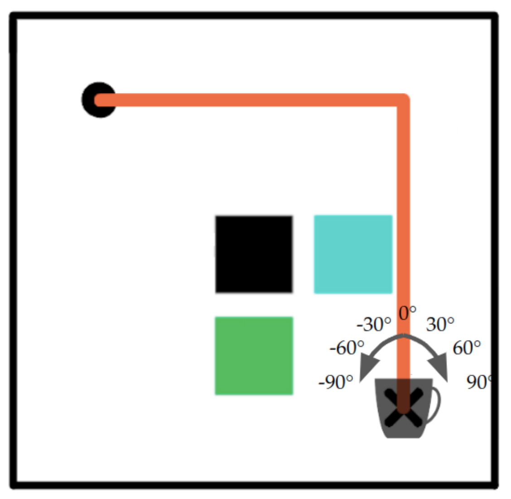
        <small style="font-size: 0.45em; color: #666;">
        Bobu, A., Liu, Y., Shah, R., Brown, D. S., & Dragan, A. D. (2023, March). Sirl: Similarity-based implicit representation learning. In Proceedings of the 2023 ACM/IEEE International Conference on Human-Robot Interaction (pp. 565-574).
        </small>
    

    

        Vehicle parking
        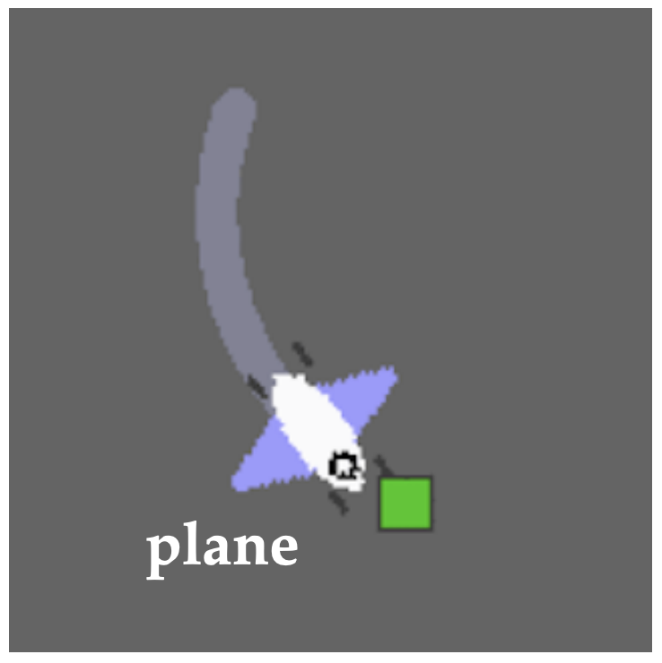
        <small style="font-size: 0.45em; color: #666;">
        Srivastava, M., Goodman, N., & Sadigh, D. (2023, July). Generating language corrections for teaching physical control tasks. In International Conference on Machine Learning (pp. 32561-32574). PMLR.
        </small>
    

    

        Swimmer (stretch)
        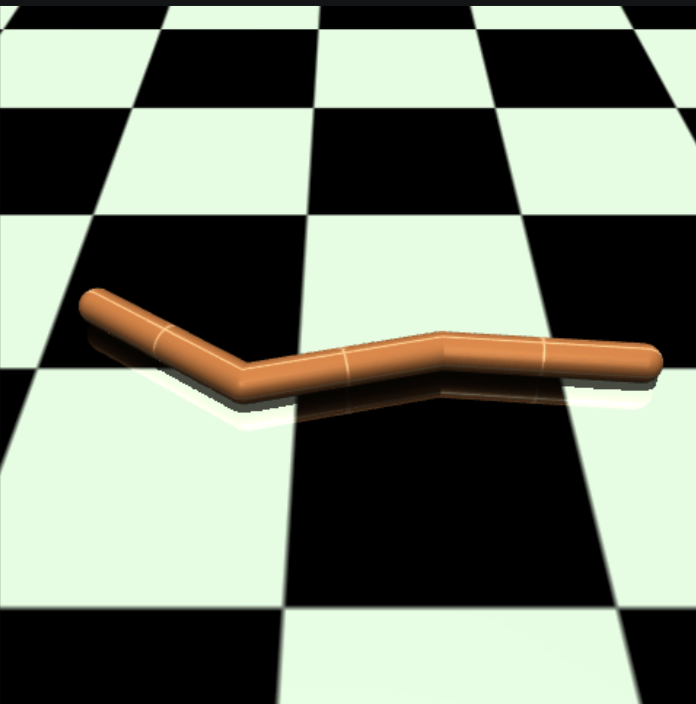
        <small style="font-size: 0.45em; color: #666;">
        Zhang, D., Carroll, M., Bobu, A., & Dragan, A. (2022). Time-efficient reward learning via visually assisted cluster ranking. arXiv preprint arXiv:2212.00169.
        </small>
    

    

    <h3>We want to specify features $\phi(s)$</h3>
    
    

    

        

        <strong> Existing methods</strong>
        

        
tedious

        
expensive

        
ambiguous

        <!-- 
uninterpretable
 -->
    

    

    

        
        

        

        intuitive
        

        

        efficient
        

        

        precise
        

        <!-- 

        interpretable by design
        
 -->
    

<!-- .slide: data-auto-animate -->
Who is the human, in <strong>human</strong>-robot interaction?

    

        
    

    

        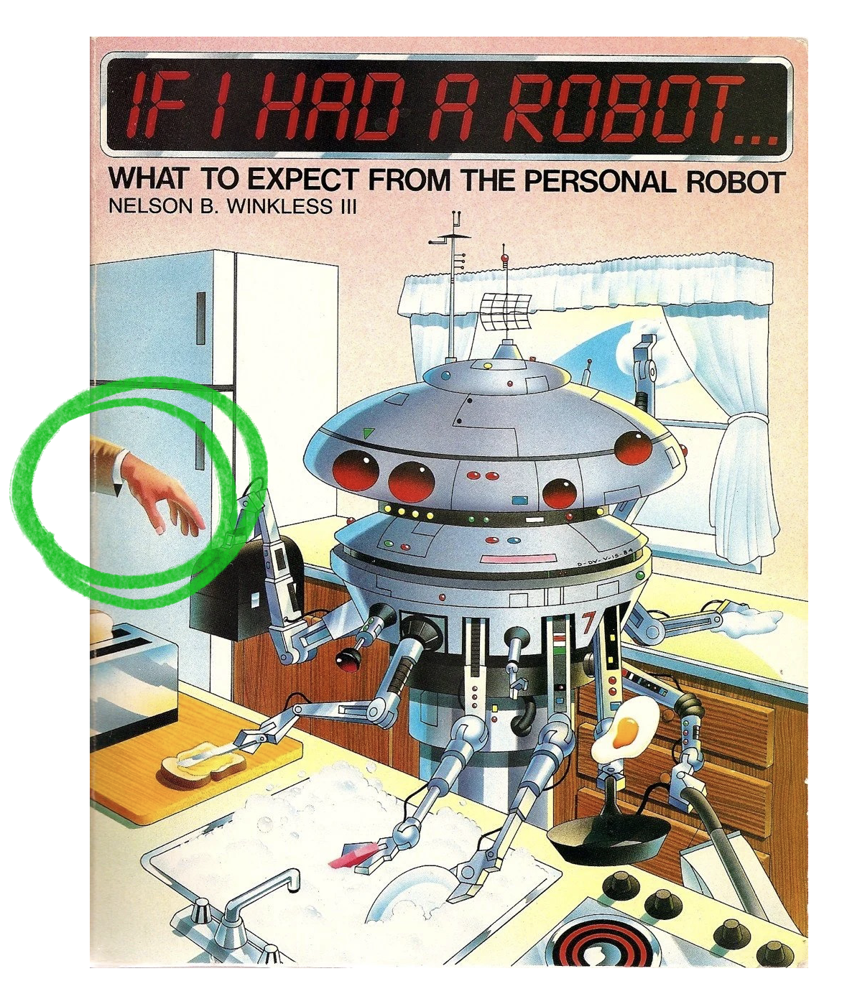
    

    

        
    

<!-- .slide: data-auto-animate -->
# Thank you!

<!--  -->
    

        
    

# Appendix

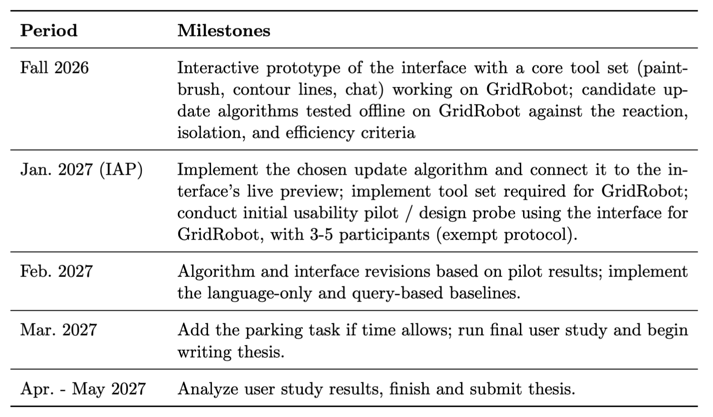

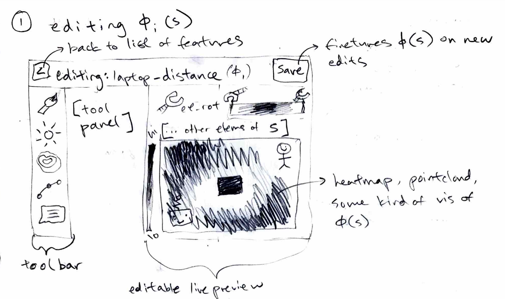

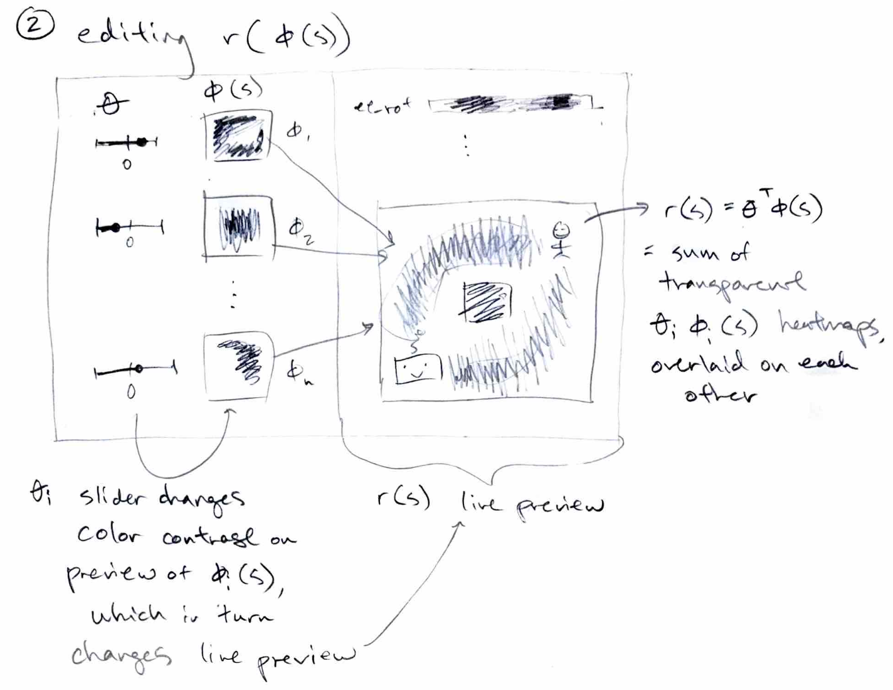